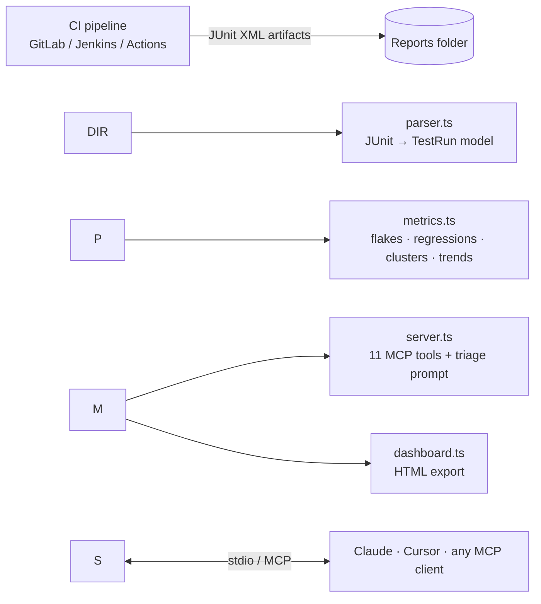

# qa-metrics-mcp

**Ask your AI assistant about your test suite in plain English, and get answers straight from your CI test reports.**

`qa-metrics-mcp` is a [Model Context Protocol](https://modelcontextprotocol.io) server that turns JUnit XML test reports into QA metrics Claude, Cursor, or any MCP client can query:

> \*"What broke in last night's run, and which commit caused it?"\*
> \*"Which tests are flaky, and how should we fix them?"\*
> \*"Write the nightly QA summary for Slack."\*
> \*"Build me a dashboard for the last two weeks."\*

No dashboards to log into, no spreadsheets to update by hand. The assistant calls the tools, reads the numbers, and explains them.

!\[QA Health Dashboard generated by the export\_dashboard tool](docs/dashboard-light.png)

\---

## Why this exists

Every QA team I've led spent hours a week on the same work: scrolling CI logs to tell a real regression from a flaky test, figuring out which build introduced a failure, and writing the same status update every morning. This server automates that triage so engineers spend their time fixing issues, not finding them.

## What it does

|Tool|What it answers|
|-|-|
|`list\_runs`|What runs do we have? Builds, commits, dates, pass rates.|
|`get\_run\_summary`|How did a run go? Totals, per-suite breakdown, every failure and skip.|
|`get\_pass\_rate\_trend`|Is quality getting better or worse? Overall or per suite.|
|`find\_flaky\_tests`|Which tests flip between pass and fail, how badly, and what's the likely fix?|
|`detect\_regressions`|What was stable and is now broken, and **which build and commit broke it**?|
|`compare\_runs`|What changed between two runs? Newly failing, fixed, slower, added, removed.|
|`get\_failure\_clusters`|Which failures share a root cause? Classified as outage, defect, intermittent, or one-off. A starting point for RCA.|
|`get\_slowest\_tests`|Where is the suite slow, and which tests are getting slower over time?|
|`get\_test\_history`|Full run-by-run history for any test.|
|`generate\_quality\_report`|A complete markdown QA health report, ready for Slack, Confluence, or Jira.|
|`export\_dashboard`|A self-contained HTML dashboard (light and dark mode, no external dependencies).|

Plus a **`nightly\_triage` prompt** that chains the tools into a full morning triage: executive summary, regressions with draft bug titles, flakes to quarantine, and incidents for DevOps.

### The smart parts

* **Outages don't pollute flake scores.** When one error signature hits 3+ tests in the same run (for example, a downstream service was down), those failures are marked as an environment incident and excluded from flakiness scoring. Healthy tests don't get blamed for a bad night.
* **Failures are clustered by root cause, not exact text.** Messages are normalized (numbers, IDs, UUIDs, and quoted values stripped), so `Timeout 15000ms` and `Timeout 30000ms` on the same locator group together.
* **Regressions are pinned to a commit.** Related breakages that started in the same build are grouped as one incident with the first bad build, its commit, and the last good build.
* **Flaky tests get a suggested fix** based on the failure pattern: timeouts, detached/stale elements, or intermittent downstream dependencies.
* **Performance drift detection** compares early-window vs recent-window runtimes and flags tests that are degrading.

## Works with your existing reports

Point it at any folder of JUnit-format XML. That covers most of the ecosystem:

* **Java:** Maven Surefire / Failsafe, TestNG, Gradle
* **JavaScript/TypeScript:** Playwright, Cypress, Jest (`jest-junit`), Vitest
* **Python:** pytest (`--junitxml`)
* **CI:** GitLab CI test report artifacts, Jenkins, GitHub Actions, Bamboo

Build metadata (build number, commit, branch, environment) is read from `<properties>` when present. Reports are re-read on every call, so new nightly artifacts show up without restarting the server.

## Quick start

```bash
git clone https://github.com/Misfit1982/qa-metrics-mcp.git
cd qa-metrics-mcp
npm install          # also compiles TypeScript to dist/
npm run smoke        # end-to-end test over real MCP stdio
```

The repo ships with 14 nightly runs of synthetic data for a fictional e-commerce app, with known problems planted in it, so every tool has something to find out of the box.

### Connect to Claude Code

```bash
claude mcp add qa-metrics -- node /absolute/path/to/qa-metrics-mcp/dist/server.js
```

### Connect to Claude Desktop

Add to `claude\_desktop\_config.json`:

```json
{
  "mcpServers": {
    "qa-metrics": {
      "command": "node",
      "args": \["/absolute/path/to/qa-metrics-mcp/dist/server.js"],
      "env": { "QA\_REPORTS\_DIR": "/absolute/path/to/your/junit-reports" }
    }
  }
}
```

### Connect to Cursor

Add the same block to `.cursor/mcp.json` in your project (or the global Cursor MCP settings).

### Configuration

|Variable|Default|Purpose|
|-|-|-|
|`QA\_REPORTS\_DIR`|`./sample-data/reports`|Folder of JUnit XML reports|
|`QA\_OUTPUT\_DIR`|`./output`|Where `export\_dashboard` writes HTML|

## Example session

> \*\*You:\*\* Triage last night's run.
>
> \*\*Claude:\*\* \*(calls `compare\_runs`, `detect\_regressions`, `find\_flaky\_tests`, `get\_failure\_clusters`)\*
>
> \*\*Summary:\*\* Pass rate is 90% (27/30). Two real regressions, both pricing-related, started in build 1210. Three flaky tests are adding noise.
>
> \*\*Regressions:\*\* Introduced in build \*\*1210\*\* (commit `9f3c2ab`). Last good: 1209.
> - `ui.cart::apply\_coupon`: cart total 89.99 vs expected 80.99 after SAVE10. \*Draft bug: "Coupon discount not applied to cart total after pricing change in 9f3c2ab"\*
> - `ui.checkout::tax\_calculation`: order total off by about $9.72. Likely the same pricing change.
>
> \*\*Quarantine candidates:\*\* `order\_webhook` (intermittent 504s from downstream), `autocomplete` (detached element), `shipping\_options` (locator timeout).
>
> \*\*For DevOps:\*\* Build 1207 had an `inventory-svc` outage (ECONNREFUSED on 6 tests). Not a product defect.

See the full generated report in [`docs/sample-report.md`](docs/sample-report.md).

## Architecture



```
src/
  parser.ts      JUnit XML → normalized TestRun / TestCase model
  metrics.ts     Pure analysis functions (no I/O, easy to unit-test)
  dashboard.ts   Self-contained HTML dashboard renderer
  server.ts      MCP server: tool definitions, input validation (zod), error handling
scripts/
  generate-sample-data.ts   Deterministic synthetic data with planted issues
  smoke-test.ts             End-to-end test via the official MCP client
```

Design choices:

* **Read-only by default.** Every analysis tool is annotated `readOnlyHint`. Only `export\_dashboard` writes a file, and only inside the output folder.
* **Errors are tool errors, not crashes.** A bad run ID returns a readable message the assistant can recover from.
* **Pure metrics layer.** All analysis is side-effect-free, so it can be reused in a CLI, a CI step, or a different server.

## Testing

`npm run smoke` launches the compiled server exactly the way Claude Desktop or Cursor does (stdio, official MCP SDK client) and asserts that every planted issue is found:

```
  ✓ exposes 11 tools
  ✓ find\_flaky\_tests finds the 3 planted flakes and ignores the outage
  ✓ detect\_regressions pins both pricing breaks to build 1210 / commit 9f3c2ab
  ✓ get\_failure\_clusters flags the build 1207 outage as environmental
  ✓ get\_slowest\_tests flags guest\_checkout degradation
  ...
All 14 checks passed.
```

## Roadmap

* Pull reports directly from the GitLab / GitHub Actions APIs
* Allure and TestNG native (`testng-results.xml`) formats
* Push the health report to Slack or Teams on a schedule
* Companion servers: **bug-report drafting** (failure → Jira ticket) and **RCA assistant** (failure cluster + commits → 5-Whys write-up)

## About

Built by **Jared Hood**, QA leader with 20 years in SaaS, fintech, and media QA (Selenium, Playwright, Tosca, RestAssured, GitLab CI, AWS). I build AI-assisted QA tooling: MCP servers, test automation frameworks, and reporting that turns test results into decisions.

*All data in this repo is synthetic and describes a fictional application.*

License: MIT

